<div align="center">

# 🏎️ Diecast Gallery

**A fast, good-looking home for your diecast car collection.**
Hot Wheels, Matchbox, Tomica, Majorette, Mini GT — catalogue every car, share it, and keep it all on Cloudflare's free tier.

[**Live demo →**](https://diecast.padmajp.com) &nbsp;·&nbsp; [Setup guide](docs/SETUP.md) &nbsp;·&nbsp; [Configuration](#configuration)

 -black) 

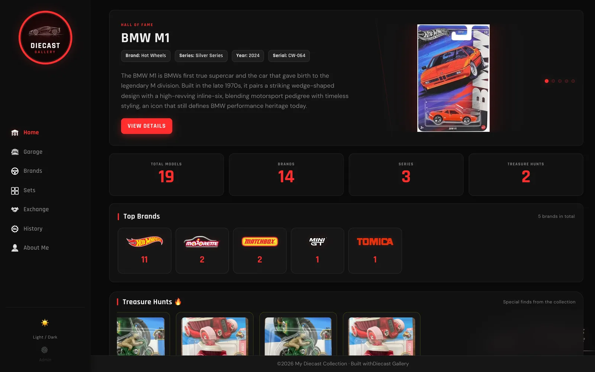

</div>

---

## What you get

| | |
|---|---|
| **Home dashboard** — Hall of Fame carousel, collection stats, top brands, treasure hunts, recently added, top gifters, wishlist, incoming orders and "on this day". | 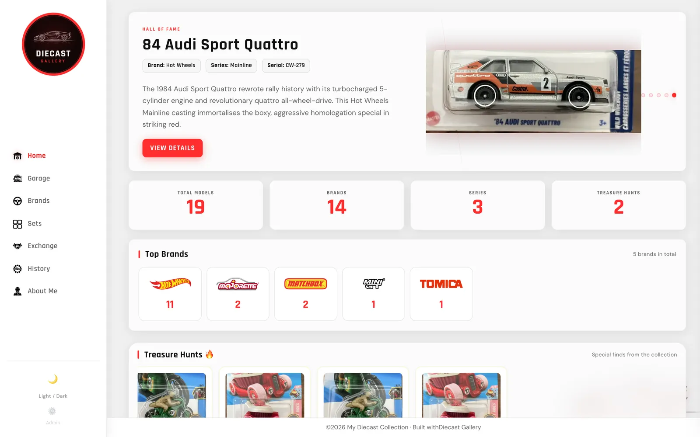 |
| **Garage** — every car with search, filters (brand, series, set, manufacturer, status, variants), sorting and pagination. Grids load small thumbnails, so it stays quick even with hundreds of cars. | 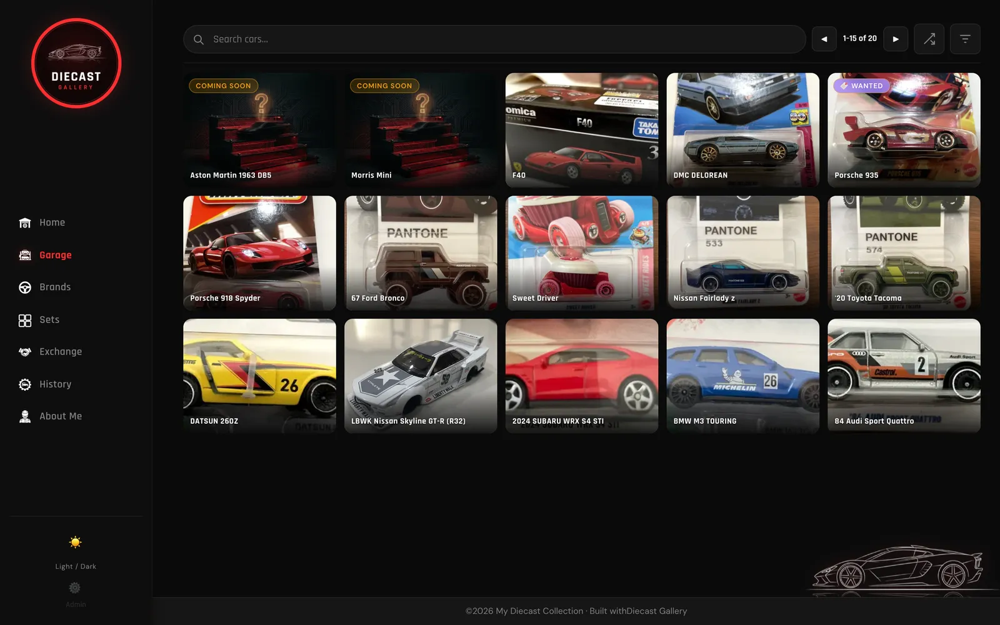 |
| **Car pages** — photo carousel with thumbnails, colour chips, variants, specs, share links with a proper preview card, plus **casting info from the Hot Wheels / Matchbox wikis** and the **real car from Wikipedia**. | 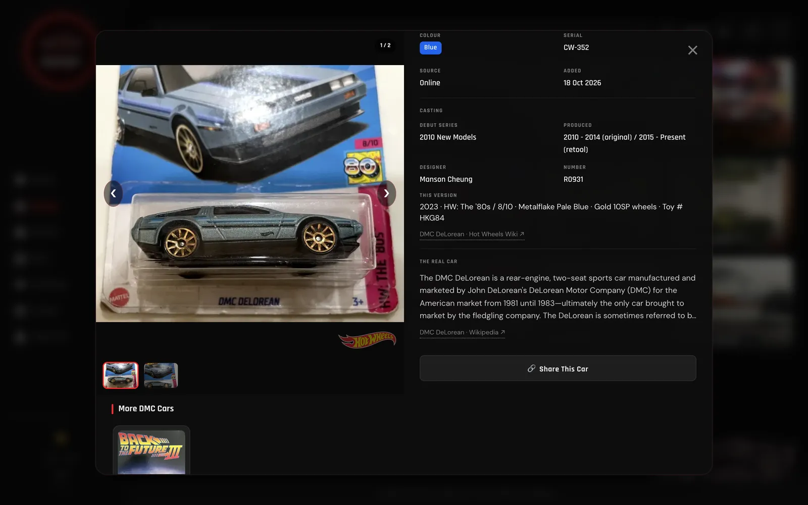 |
| **Brands** — one page per real-car manufacturer, with logos and stats. | 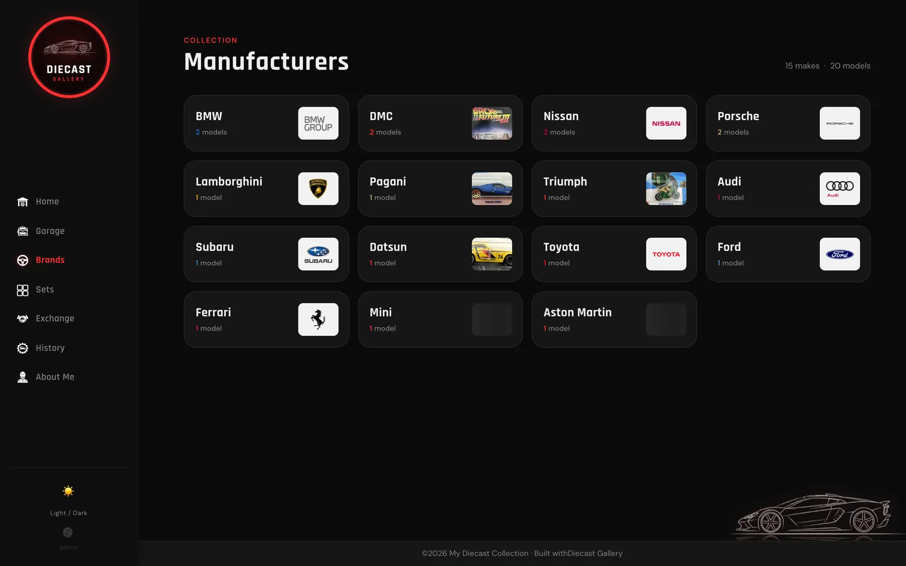 |
| **Sets** — themed sets and multipacks with logos and completion bars. | 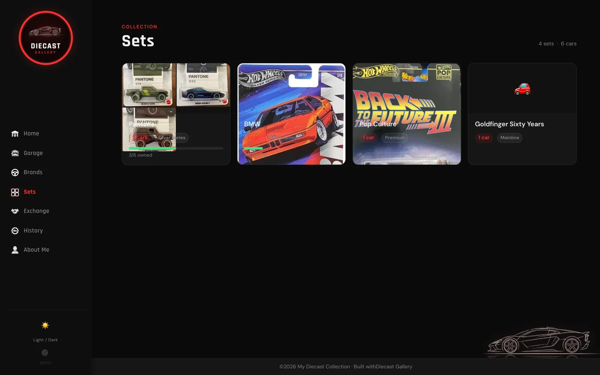 |
| **⌘K search** — jump to any car from anywhere. | 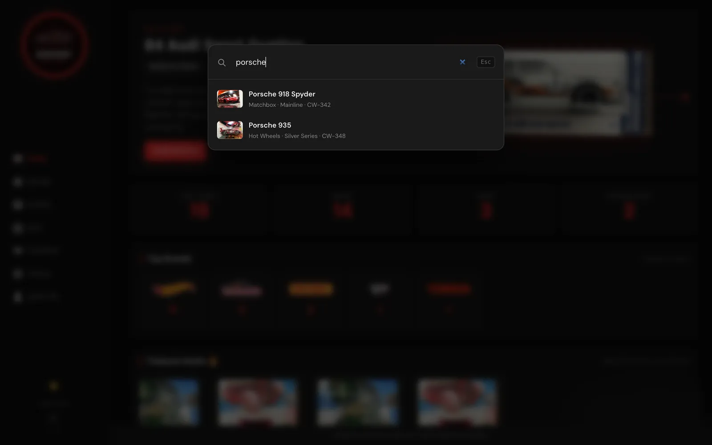 |

**Built for phones too** — a bottom dock, swipeable photos and a full-screen car view:

<p align="center">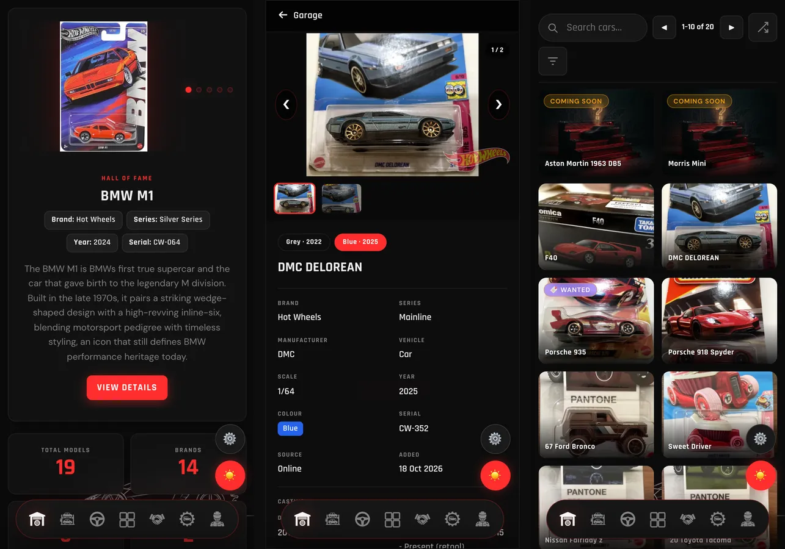</p>

### Admin panel

A password-protected `/admin` to run the collection from your phone or laptop — no spreadsheets, no redeploys.

| Manage cars | Add a car | Match it to the wiki |
|---|---|---|
| 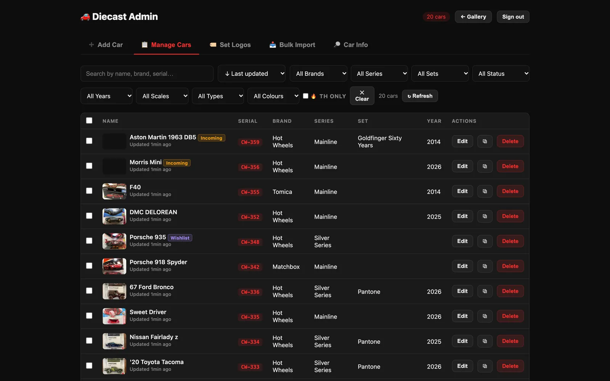 | 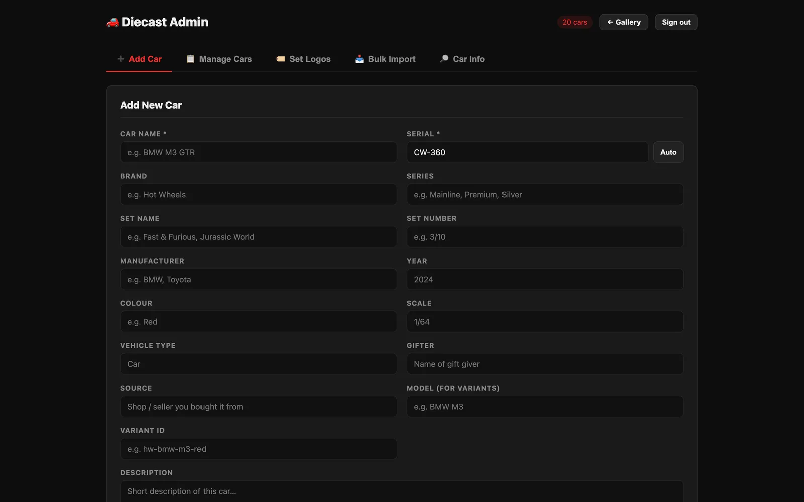 | 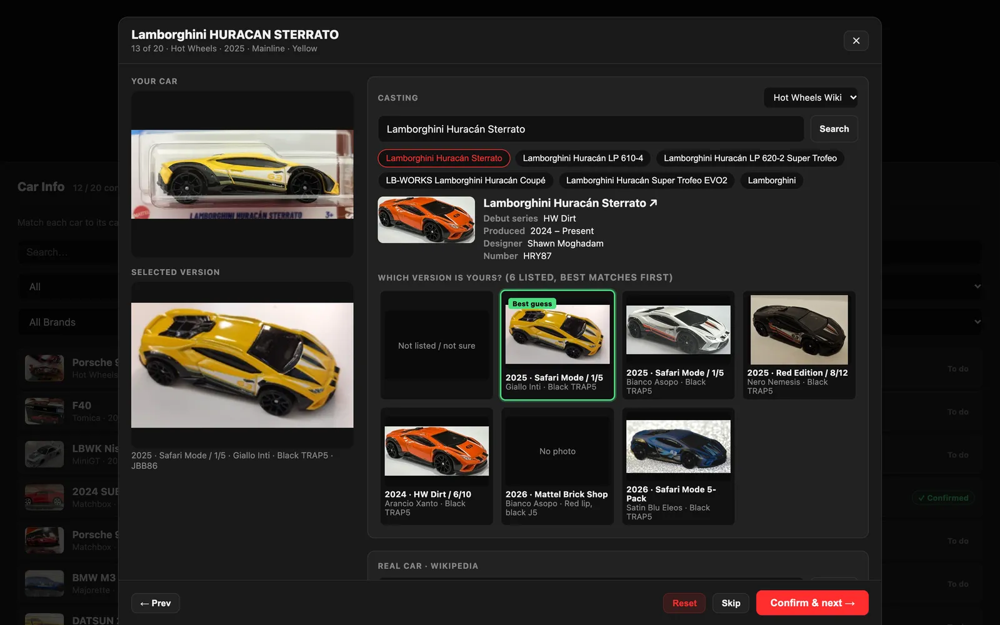 |
| Search, filter, sort by last updated, bulk edit, duplicate, undo delete. | Photos are resized, converted to WebP and given a thumbnail **in your browser** before upload (HEIC from iPhones works). | **Car Info** finds the casting on the wiki, ranks every release by year and colour (even Italian names like *Rosso* or *Giallo*), and lets you confirm yours by comparing photos. Only confirmed matches appear on the site. |

Also: set logos, CSV bulk import, a "⚠ Needs check" list that flags suspicious matches.

---

## Two ways to run it

| | **Demo mode** | **Full mode** |
|---|---|---|
| What | Static site with bundled sample data | Your own data in Cloudflare D1 + admin panel |
| Needs | Nothing (any static host) | Free Cloudflare account, a GitHub repo for photos |
| Time | 1 minute | ~20 minutes, [step by step](docs/SETUP.md) |

### Try it in a minute (demo mode)

```bash
git clone https://github.com/padmajp4/Diecast-gallery-ui.git
cd Diecast-gallery-ui
npx wrangler pages dev public     # → http://localhost:8788
```

The site can't find an API, so it loads `public/data/sample-cars.json` (20 sample cars) and works fully offline.
Any static server works too — `npx serve public`, Python's `http.server`, etc.

### Make it yours (full mode)

Follow **[docs/SETUP.md](docs/SETUP.md)**. In short:

```bash
npx wrangler login
npx wrangler d1 create diecast-db              # copy the id into worker/wrangler.toml
npm run db:schema                              # create tables (optional: npm run db:seed)
npx wrangler pages project create my-diecast
npm run deploy:site                            # → https://my-diecast.pages.dev
# edit worker/wrangler.toml → [vars], routes
npx wrangler secret put ADMIN_SECRET --config worker/wrangler.toml
npx wrangler secret put GITHUB_TOKEN --config worker/wrangler.toml
npm run deploy:worker                          # → your site, with /admin
```

---

## How it works

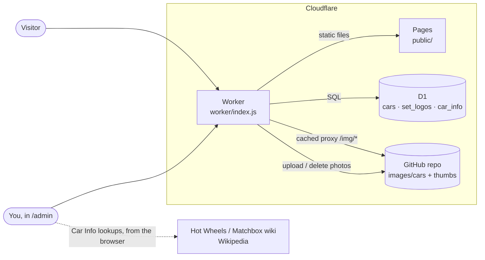

- **Pages** serves the site (`public/`): plain HTML, CSS and ES modules — no build step, no framework, no npm packages at runtime.
- **The Worker** sits in front of it and adds the JSON API, the admin API, a long-cache image proxy, `sitemap.xml`, and share links (`/?car=BMW%20M1`) with per-car Open Graph tags.
- **D1** (Cloudflare's SQLite) stores the collection.
- **Photos live in a GitHub repo** you own — free, versioned, and served through Cloudflare's edge cache.

---

## Configuration

### `worker/wrangler.toml` → `[vars]`

| Variable | Example | What it's for |
|---|---|---|
| `SITE_URL` | `https://diecast.example.com` | Your public URL — share links, sitemap, admin CORS |
| `ORIGIN_URL` | `https://my-diecast.pages.dev` | Your Cloudflare Pages URL (the Worker forwards page requests here) |
| `GITHUB_REPO` | `you/diecast-images` | Public repo that stores photos |
| `GITHUB_BRANCH` | `main` | Branch in that repo |
| `SITE_TITLE` | `Sam's Diecast Collection` | Used in share-link previews |
| `SITE_DESCRIPTION` | `…` | Default share-link description |

**Secrets** (set with `npx wrangler secret put <NAME> --config worker/wrangler.toml`, never committed):

| Secret | What it's for |
|---|---|
| `ADMIN_SECRET` | The `/admin` password. Use something long — 10 wrong tries locks an IP out for 15 minutes. |
| `GITHUB_TOKEN` | Fine-grained GitHub token with **Contents: Read and write** on `GITHUB_REPO` only. Used to upload/delete photos. |

### `public/js/config.js`

Turn home sections on/off, change counts and carousel timing, map colour names to chip colours, and point the site at its data:

```js
dataUrl: "/api/cars",                   // the Worker API
sampleDataUrl: "data/sample-cars.json", // fallback when there's no API — set "" when you go live
showTreasureHunts: true,
recentCount: 3,
heroAutoplayInterval: 5000,
CAR_COLOURS: { "red": "#dc2626", "blue black": ["#2563eb", "#1c1c1c"], … },
```

---

## Customising

| To change… | Edit |
|---|---|
| Site name, description, social preview URLs | `<head>` of `public/index.html` (marked with a comment) |
| About page text, photo, social links | `#view-aboutme` in `public/index.html` |
| Logo / favicons / share image | `public/images/logo.webp`, `public/favicon*`, `public/apple-touch-icon.png`, `public/og-image.webp` |
| "No photo" image | `public/images/default_placeholder.webp` (or `placeholderImage` in `config.js`) |
| Toy-brand logos (Hot Wheels, Matchbox…) | `public/brands/*.png` + the `BRAND_LOGOS` map in `js/home.js` and `js/modal.js` |
| Manufacturer logos (Ferrari, Nissan…) | `public/images/manufacturer-logos/` + `BRAND_LOGO_FILE` / `BRAND_THEME` in `js/brands.js` |
| Colours, fonts, layout | `public/styles.css`, then `npm run build:css` (the site loads `styles.min.css`) |
| Analytics / cookie banner | `public/js/site.js`, and allow its domains in `public/_headers` (Content-Security-Policy) |

---

## Data model

One row per car in D1 (`db/schema.sql`). The API returns these fields:

| API field | Column | Notes |
|---|---|---|
| `name` | `name` | Required |
| `serial` | `serial` | Your catalogue number (`CW-001`); admin suggests the next one |
| `brand` | `brand` | Toy brand — Hot Wheels, Matchbox… |
| `series`, `year`, `Scale`, `VehicleType`, `Colour` | `series`, `year`, `scale`, `vehicle_type`, `colour` | |
| `Manufacture` | `manufacture` | Real-car maker; use `Fantasy` for original castings |
| `images` | `images` | JSON array of URLs; the first is the cover |
| `featured`, `featuredImage` | `featured`, `featured_image` | Hall of Fame carousel |
| `isTreasurehunt` | `is_treasure_hunt` | |
| `model`, `variantId`, `variantLabel` | `model`, … | Same `model` = variants of one casting (switchable in the car page) |
| `ownership` | `ownership` | `{"quantity": 2}` — more than one shows in **Exchange** |
| `Gifter`, `source` | `gifter`, `source` | Who gave it / where it came from |
| `isIncoming`, `isWishlist` | `is_incoming`, `is_wishlist` | Ordered-but-not-here / wanted |
| `setName`, `setNumber` | `set_name`, `set_number` | Themed sets and multipacks |
| `addedOn`, `updatedAt` | `created_at`, `updated_at` | |

Images are stored at `images/cars/<name>` in your GitHub repo, with a 480 px copy at `images/cars/thumbs/<name>`. Already have photos without thumbnails? Run [`scripts/make-thumbnails.sh`](scripts/make-thumbnails.sh) in that repo.

<details>
<summary><b>API reference</b></summary>

| Method | Path | Auth | Returns |
|---|---|---|---|
| GET | `/api/cars` | — | All cars (edge-cached 5 min) |
| GET | `/api/cars/:id` | — | One car |
| GET | `/api/set-logos` | — | `{ "Set name": "logo url" }` |
| GET | `/api/car-info/:id` | — | Confirmed wiki info for a car, or `null` |
| GET | `/img/images/…` | — | Image from the GitHub repo, cached for a year |
| GET | `/sitemap.xml` | — | Every page, brand, set and car |
| GET | `/admin/api/ping` | ✔ | `{ ok: true }` — used by the login screen |
| GET | `/admin/api/next-serial` | ✔ | Next free `CW-NNN` |
| POST | `/admin/api/upload` | ✔ | `{ filename, base64, thumbBase64? }` → `{ url }` |
| POST / PUT / DELETE | `/admin/api/cars[/:id]` | ✔ | Create / update / delete a car |
| POST / DELETE | `/admin/api/set-logos[/:name]` | ✔ | Save / remove a set logo |
| GET / PUT / DELETE | `/admin/api/car-info[/:id]` | ✔ | Car Info rows (`status`: `confirmed` \| `skipped`) |

Admin calls send `Authorization: Bearer <ADMIN_SECRET>`.
</details>

---

## Project structure

```
public/                  ← deployed to Cloudflare Pages
├── index.html           single-page app shell
├── styles.css           source styles (styles.min.css is what loads)
├── js/
│   ├── app.js           boot, routing, data loading, ⌘K search
│   ├── config.js        feature flags + colours
│   ├── home.js          dashboard
│   ├── allCars.js       garage grid, filters, pagination
│   ├── modal.js         car page, carousel, wiki info
│   ├── brands.js        manufacturer hub + pages
│   ├── sets.js          sets hub + pages
│   ├── exchange.js      duplicates
│   ├── carImage.js      thumbnails + image fallbacks
│   ├── theme.js         light / dark
│   └── site.js          page-level extras (analytics goes here)
├── admin/               admin panel (index.html, carinfo.js)
├── data/sample-cars.json  demo data
├── images/, brands/, gifters/
└── _headers, _redirects security headers (CSP) + SPA routing
worker/
├── index.js             the Worker (API, admin API, image proxy, sitemap, OG tags)
└── wrangler.toml        configuration
db/
├── schema.sql           tables
└── seed.sql             the 20 sample cars
scripts/make-thumbnails.sh
docs/                    setup guide + screenshots
```

---

## Security & performance

- **Admin**: one password (`ADMIN_SECRET`), constant-time check, per-IP lockout after 10 failures. Uploads accept images only and get safe file names.
- **Content-Security-Policy**: the public site runs with no inline scripts (`public/_headers`); share-link pages get the same headers.
- **Images**: the proxy only serves image files under `images/`, with `nosniff`; deleting a car never deletes a photo another car still uses.
- **Fast by default**: 480 px thumbnails in every grid (about 18 KB instead of 150 KB), lazy loading, one cached API call, module preloading, minified CSS, and no framework to download.

## Cost

Everything fits Cloudflare's free tier for a personal collection: Pages (unlimited static requests), Workers (100k requests/day), D1 (5 GB). Photos live in a free public GitHub repo. A custom domain is optional.

## FAQ

**Do I need a custom domain?** No — remove the `routes` block in `worker/wrangler.toml` and use the `*.workers.dev` URL as `SITE_URL`.

**Can I keep photos private?** The image proxy reads public `raw.githubusercontent.com` URLs, so the photo repo must be public. The collection data itself lives in D1.

**I only want a static site.** Put your cars in `public/data/sample-cars.json` (same fields as above) and deploy `public/` anywhere. You lose the admin panel and wiki info, nothing else.

**The Hot Wheels wiki doesn't know my brand.** Car Info supports the Hot Wheels and Matchbox Fandom wikis; every brand still gets the Wikipedia "real car" section.

## Credits

Built by [Padmaj P Kumar](https://github.com/padmajp4) — see the original collection at [diecast.padmajp.com](https://diecast.padmajp.com).
Casting data comes from the community-run [Hot Wheels Wiki](https://hotwheels.fandom.com) and [Matchbox Wiki](https://matchbox.fandom.com), and real-car summaries from [Wikipedia](https://en.wikipedia.org) — all CC BY-SA; the site links back to every source it shows.

Brand and manufacturer names and logos belong to their owners and are included only to label cars. This project isn't affiliated with Mattel, Tomica/Takara Tomy, Majorette or any car maker.

## License

[MIT](LICENSE) — use it, change it, share your collection.
